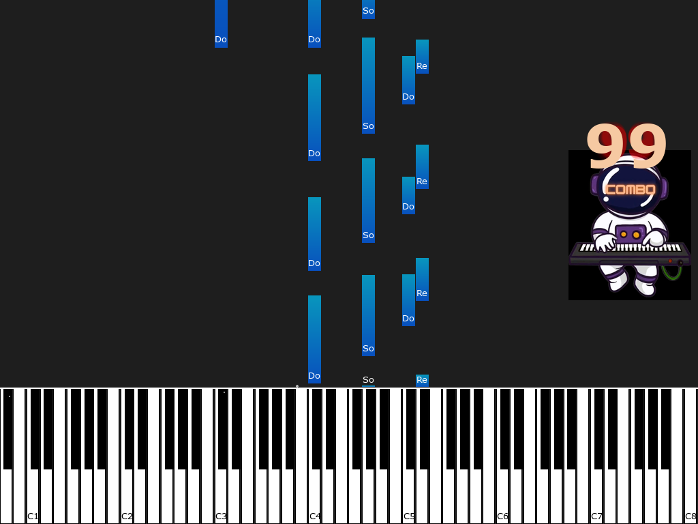
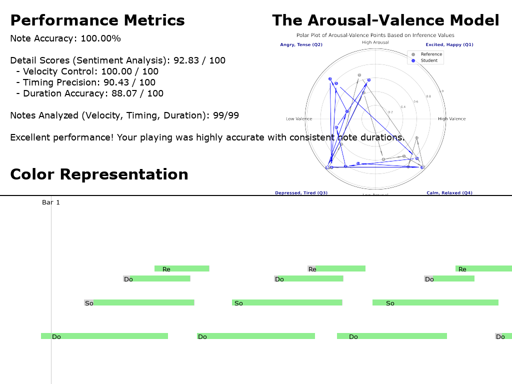

# VirtuPlay Maestro

A piano practice app that scores **how** a beginner plays, not only **which** notes they hit.
A student plays along with a falling-note view on a MIDI keyboard. Each note is then compared
with a teacher's reference recording for pitch, timing, dynamics, duration and pedalling. The
app also plots per-bar emotion (arousal–valence) for teacher and student and writes a short
tutor-style comment with an LLM.

Senior capstone project, Department of Information Management, National Taiwan University
(Feb–Dec 2024, team of four, graded A+). [Demo video](https://youtu.be/CMjvzO9doVc) ·
[Poster](https://drive.google.com/file/d/1lEGxhHRoFR3aTlsQK78DJi2s7HEFd1YX/view?usp=sharing)

| Practice view | Performance report |
| --- | --- |
|  |  |

## How it works

1. **Reference.** The teacher's MIDI file is rescaled to the practice tempo and shifted so
   the first note starts at 0 (`midi_io.load_reference`).
2. **Live matching.** For each key the student presses, `scoring.find_matching_reference`
   looks for the reference note with the same pitch and the closest onset within a time
   tolerance (0.2 s by default). A match increases the combo; a miss resets it.
3. **Scores** (`scoring.py`), each 0–100:
   - pitch accuracy, averaged over every played note
   - velocity: −2 per velocity unit of difference
   - timing: −20 per 0.1 s of onset difference
   - duration: ratio of the shorter to the longer note length
   - pedal presses are matched on both press time and hold length
4. **Report.** Notes are recoloured by dynamics (correct / too hard / too light / wrong) on a
   time × pitch view, with bar markers and the pedal timeline. Tolerances can be changed
   from the report and the view updates. The report can be exported to PDF.
5. **Emotion.** Both performances are split into bars. A pretrained EMOPIA classifier
   predicts arousal and valence for each bar, and the two trajectories are plotted together.
6. **AI comment.** Both performances are sent to an LLM as MIDI text, with three annotated
   example pairs in the prompt (few-shot), and the model returns up to three sentences of
   feedback.

## Project layout

```
virtuplay/
  app.py            DynamicMusicSheet: state, main loop, composes the mixins below
  config.py         paths, default tempo, tolerances, colours
  scoring.py        pure scoring functions (unit-tested)
  midi_io.py        load reference MIDI, convert recorded events to a MIDI file
  evaluation.py     live matching, score bookkeeping, report text
  recording.py      MIDI input thread, metronome, start/stop recording
  feedback.py       few-shot LLM comment
  emotion/          bar splitting, EMOPIA inference, arousal-valence plot
  ui/               practice view, report view, menus, widgets, particle effects
assets/             reference and few-shot MIDI files, images
tests/              pytest suite for scoring and MIDI I/O
```

## Running

Requires Python 3.9+ and, for live play, a MIDI keyboard.

```bash
python -m venv .venv && source .venv/bin/activate
pip install -r requirements-dev.txt
pytest                                   # scoring and MIDI I/O tests
export OPENAI_API_KEY=...                # optional, enables the AI comment
python -m virtuplay --reference assets/reference/3_t3.mid --bpm 108
```

Recordings, emotion plots and PDF reports are written to `outputs/`.

## Team and my role

Four-person team; the original development history is in
[Leonard-Tsai-2003/2024-IM-Project](https://github.com/Leonard-Tsai-2003/2024-IM-Project).

**Cheng-Tse (Justin) Shih** proposed the project idea, designed the note-level scoring metrics,
built the visualizations (falling-note practice view, report, pedal timeline,
arousal–valence plots) and worked on the AI comments. Teammates worked on applying the emotion
model, the AI comments and code optimization.

This repository is a restructured version of the final capstone code. I split the original
single 2,400-line script into modules, moved the scoring logic into pure functions with tests,
and moved the API key into an environment variable. Running the original and the refactored
code on the same simulated performance produces identical scores, note colours and pedal
results.

## Acknowledgements

The emotion model and pretrained weights in `virtuplay/emotion/` are adapted from the EMOPIA
emotion classifier: H.-T. Hung et al., *EMOPIA: A Multi-Modal Pop Piano Dataset for Emotion
Recognition and Emotion-based Music Generation*, ISMIR 2021.
